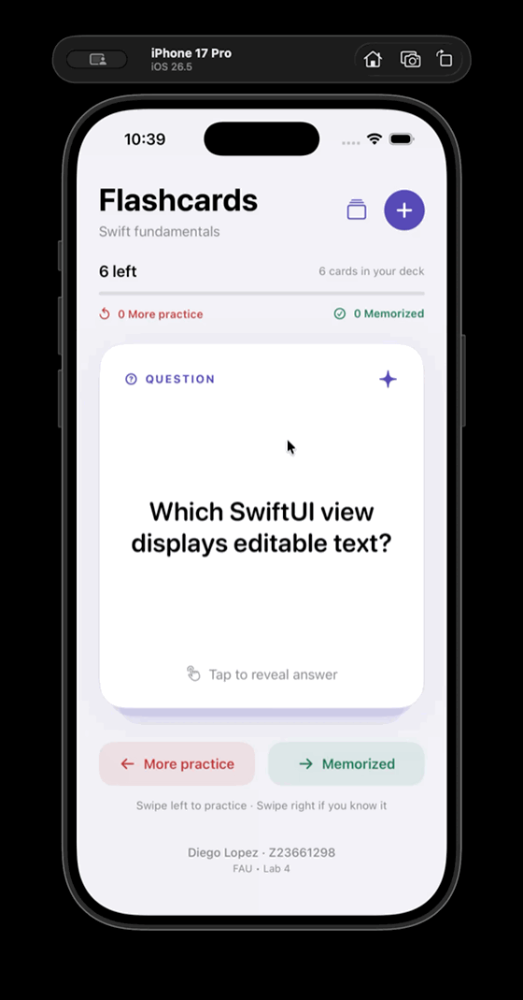

# Lab 4 — Flashcards

- **Name:** Diego Lopez
- **Z number:** Z23661298
- **Course:** FAU Mobile App Projects, Fall 2026
- **Prepared:** October 24, 2026
- **Submission date:** October 24, 2026
- **Assigned repository:** https://github.com/FAU-Fall2026-iOS-Mobile-App/lab4-diegolopez2022
- **Public copy:** https://github.com/bjjlops/lab4-diegolopez2022

Flashcards is a native SwiftUI study app with five sample cards about SwiftUI fundamentals. Tap a card to switch between its question and answer. Swipe left to place a card in **More Practice**, or right to mark it **Memorized**. The card changes color and shows a direction label during a drag. The deck tracks the cards left and the count in each pile.

## Features

- [x] View a flashcard and toggle between its question and answer.
- [x] Show red/green feedback and a category label while swiping.
- [x] Swipe left and right to advance through the deck.
- [x] Reset the complete deck after finishing a round.
- [x] Review only the cards marked as needing more practice.
- [x] Create new cards using a modal question-and-answer form.
- [x] Reject empty or whitespace-only questions and answers.
- [x] Display Diego Lopez and Z23661298 at the bottom of the main screen.
- [x] Bonus: save custom cards and study progress across app launches.
- [x] Bonus: delete saved cards from the card library.
- [x] Provide sorting buttons and VoiceOver actions as alternatives to dragging.
- [x] Embed the walkthrough GIF converted from Diego's own recording.

## Development description

The project begins with Xcode's iOS App template using SwiftUI, Swift, and no database framework. `FlashcardApp` opens `ContentView`, which lays out the header, progress indicator, card stack, sorting controls, and student footer using SwiftUI stacks. The view reads observable model state, so changes to the deck update the screen automatically.

`StudyDeck` owns the card data and three separate piles identified by stable UUIDs. A reviewed card moves from the remaining pile to the practice or memorized pile. A practice round returns only the practice cards and preserves the memorized pile. Reset All Cards restores every saved card exactly once and clears both reviewed piles. Stable identities and a new session identity on reset ensure the question side and drag state start fresh each round.

`CardView` keeps its answer visibility and drag translation in local `@State`. Tapping changes the displayed text. A horizontal `DragGesture` moves and rotates the card, progressively applies a red or green tint, and shows a direction label. A drag past 100 points completes the swipe; a shorter drag springs back without classifying the card. Reduced Motion removes the rotation and shortens the dismiss animation. Only the front card accepts study actions.

`CreateFlashcardView` uses a modal sheet with question and answer fields. Save is disabled until both contain non-whitespace text. Saving trims the text and inserts the card at the front of the remaining deck; Cancel leaves the deck unchanged. Long questions and answers can scroll inside the card. `CardLibraryView` lists saved cards and offers deletion with an in-app confirmation.

`CardStore` uses Observation to connect the model to SwiftUI. It encodes the complete deck as JSON in the app's local UserDefaults after each change. Custom cards, classifications, resets, and deletions therefore survive relaunches. No account, backend, API key, external package, or network connection is required.

## Run locally

1. Open `Flashcard/Flashcard.xcodeproj` in Xcode.
2. Choose the **Flashcard** scheme and an iPhone simulator.
3. Run the project. It supports iOS 17 or later.

For a physical iPhone, choose your own signing team in Xcode before running. Simulator builds do not need a signing team.

## Walkthrough

Recorded by Diego on October 24, 2026. The walkthrough shows question-and-answer flipping, red and green swipe feedback, both sorting directions, a completed round, practice-only review, a full reset, and creating and revealing a new card. The student identification footer is visible on the main screen.



The GIF preserves the complete student recording in order: approximately 92 seconds at 560 × 1069 pixels (2.9 MB).

## Validation

Run the model and persistence checks locally:

```sh
zsh Tests/run-tests.sh
```

The checks cover swipe classification, stale callback protection, practice-only rounds, repeated full resets, blank input, text trimming, deletion from each pile, empty-deck behavior, JSON identity preservation, and restoring saved state. Simulator interaction results are recorded separately in [VERIFICATION.md](VERIFICATION.md).

## References

Built for [CodePath IOS102 Unit 4 Lab: Flashcard](https://courses.codepath.org/courses/ios102_swiftUI/unit/4#!labs), following the FAU Canvas Lab 4 requirements. The implementation uses the lab's SwiftUI concepts with a separate deck model, local persistence, and accessibility alternatives.
